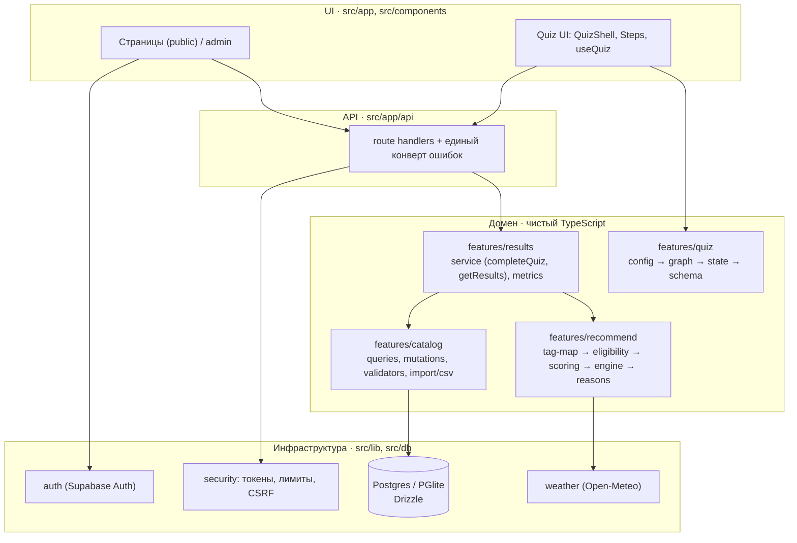
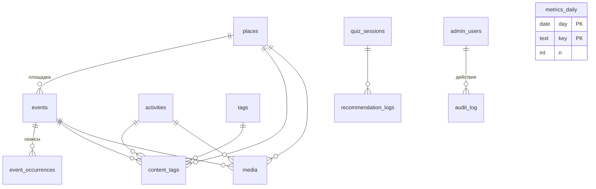
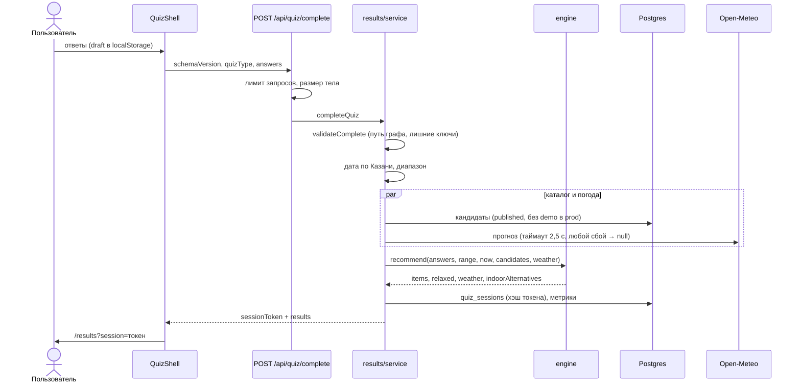

# Архитектура ӘЙДӘ ИНДЕ!

Обзор для разработчиков. Требования — `CLAUDE_CODE_SPEC.md`, решения и отклонения — `DECISIONS.md`, граф теста — `QUIZ_GRAPH.md`.

## 1. Принципы
1. **Детерминированность.** Подборка — чистые функции без AI и сети; один вход — один результат. Генеративный AI в будущем смеет только объяснять, но не влияет на валидность ветвления и не сочиняет карточки.
2. **Бизнес-логика вне React.** Граф теста, фильтры, скоринг — обычный TypeScript, тестируется без браузера. UI — тонкий слой.
3. **Одна схема на клиенте и сервере.** Zod-схемы строятся из конфига теста; сервер ничему не доверяет.
4. **Контент не выдумывается.** Неизвестное остаётся неизвестным (`NULL`, а не `0`; «не знаем», а не «подходит всем»).
5. **Приватность по умолчанию.** Нет регистрации и персональных данных; ответы не в URL; токены хранятся хэшем; аналитика — только счётчики.
6. **Деградация без отказа.** Сбой погоды, Redis или БД-счётчиков не ломает основной путь.

## 2. Слои

Зависимости направлены вниз: домен не знает про Next.js и БД-драйвер (запросы получают `Db` аргументом).

## 3. Карта модулей

| Путь | Роль |
|---|---|
| `features/quiz/config` | 29 шагов теста (тексты дословно из ТЗ). Единственный источник графа |
| `features/quiz/{graph,state,schema,direction,progress}` | Обход графа, state machine, валидация Zod, меню направлений, оценка оставшегося |
| `features/recommend/{tag-registry,tag-map}` | Словарь тегов и таблица «ответ → теги» |
| `features/recommend/{eligibility,scoring,engine,reasons}` | Жёсткие фильтры, баллы 0–100, стадии fallback, разнообразие, объяснения |
| `features/catalog/{queries,mutations,validators}` | Чтение публичных данных, запись админки, правила публикации |
| `features/catalog/{import,csv,csv-import,csv-schema,slug}` | Импорт из JSON и таблиц (Excel/CSV) |
| `features/catalog/{attention,launch-check}` | Что перепроверить; барьер перед запуском |
| `features/results/{service,metrics}` | Сценарии `completeQuiz` / `getResults`, приватные счётчики |
| `lib/{date-kazan,env,errors,security,weather,auth,preview}` | Время Казани, окружение, ошибки API, защита, погода, вход |
| `db/{schema,client,seed-demo}` | Схема Drizzle, подключение (Postgres / PGlite), демо-данные |
| `app/api/**` | Тонкие обработчики: лимит → валидация → сервис → ответ |
| `scripts/` | Миграции, сид, импорт, проверка запуска, выдача прав |

## 4. Модель данных

- `place` — постоянная площадка; `event` — событие в дату/время (+ сеансы); `activity` — идея на дом без адреса и даты.
- Все контентные таблицы имеют `status` и `isDemo`. Публично видно только `published` (для событий ещё `cancelled`/`sold_out` с корректным статусом), demo — только вне production.
- RLS включён везде **без политик**: прямой доступ через Supabase API закрыт, чтение — только через серверный код.

## 5. Поток «Пройти тест → подборка»

Открытие ссылки (`GET /api/results/:token`) **пересчитывает** подборку по актуальному каталогу; дата («сегодня/выходные») берётся зафиксированной при выдаче.

## 6. Безопасность
| Угроза | Мера |
|---|---|
| Подмена ответов | Сервер валидирует путь графа; лишние/неизвестные ключи → `INVALID_ANSWER` |
| Угадывание ссылок | 24 случайных байта; в БД HMAC; одинаковый ответ для неверного и несуществующего токена |
| Чтение черновиков | Фильтры `published` во всех публичных запросах; предпросмотр только с сессией редактора |
| XSS | Нет HTML из БД: описания и шаги рендерятся как текст; CSP без внешних источников |
| CSRF админки | Проверка Origin + обязательный JSON |
| Перебор/нагрузка | Лимиты по клиенту; общий счётчик в Redis при наличии, иначе память |
| Права | `editor` — запись; `admin` — удаление; проверка на каждой странице и в каждом API |
| Утечки | Единый конверт ошибок без stack trace; ключи только на сервере |
| Картинки | Только https и домены из `IMAGE_HOSTS`; без подтверждённых прав не показываются |

## 7. Тестовая пирамида
- **Unit** (чистая логика): граф, фильтры, скоринг, даты, CSV, погода, лимиты.
- **Integration** (реальный SQL на PGlite): каталог, API-обработчики, админ-права, импорт, счётчики, форма админки (jsdom).
- **E2E** (Playwright, 390px и десктоп): пользовательские пути, админка, приватность и заголовки, **axe WCAG AA**.
- Дымовые гейты перед запуском: `content:check`, ручной вход Supabase.

## 8. Точки расширения
| Что | Как подключается |
|---|---|
| **DateQuiz** (`/date`) | Отдельный `quizType='date'`, свой конфиг/граф/тесты; общего состояния с `main` нет (API уже отвергает чужой тип) |
| **Telegram-бот** | Ещё один клиент существующих `POST /api/quiz/complete` и `GET /api/results/:token` |
| **AI-объяснения** | Слой над готовым результатом: на вход `reasons` и теги, на выход только текст; не влияет на отбор |
| **Внешние события** | Новый источник → записи в `events` через те же `validators` и `import` (`verifiedAt` обязателен) |
| **Мультигород** | Часовой пояс и каталог параметризуются; сейчас константа `Europe/Moscow` |
| **Общий кэш** | `RateStore` уже подключаемый; тот же приём для кэша каталога |

## 9. Окружения
| | Локально | Preview | Production |
|---|---|---|---|
| БД | PGlite (`.pglite/`) | Postgres | Postgres (Supabase) |
| Demo | по `ALLOW_DEMO_CONTENT` | по флагу | **никогда** |
| Вход админки | Supabase или тестовый (`E2E_AUTH`) | Supabase | Supabase |
| Лимиты | память | Redis/память | Redis (рекомендуется) |
